# Sequel Mod - enchantments

Every enchantment, laid out like the [Minecraft Wiki's enchantment page](https://minecraft.wiki/w/Dungeons:Enchantment). Base game numbers come from the wiki; where the mod changes a number the mod's is shown, and **What changed** says how. Every raw number is in [CHANGES.md](CHANGES.md). Icons: the game's, from the wiki; the new enchantments' icons are the mod's own.

**Enchantment points per tier (I / II / III):** Common 1 / 2 / 3, Powerful 2 / 3 / 4; gilded (a free built-in on gilded gear) one more each. **Multiple** = can roll in more than one slot of the same item. **Mobs** = enchanted mobs can roll it. **Short line** = what an item card shows under the item for a built-in copy.

## New enchantments

Each one takes over the slot of a weak or unused game enchantment (the mod changes no game code). **Gear** = what it rolls on.

| Icon | Name | Description | Tier text | I | II | III | Rarity (points) | Mobs | Multiple | Built into | Short line | What changed |
|---|---|---|---|---|---|---|---|---|---|---|---|---|
|  | **Ancient Alchemy** (Armor) | Using a healing potion grants souls. | souls per potion | 60 | 90 | 120 | Common (1 / 2 / 3) | ✖ | ✖ | None | Potions grant souls | Replaces Recycler. |
|  | **Artifact Amplifier** (Armor) | Your artifacts deal more damage and you gather more souls. | more artifact damage and souls | 20% | 35% | 50% | Powerful (2 / 3 / 4) | ✖ | ✖ | None | More artifact damage and souls | Replaces Gravity Pulse. |
|  | **Barrier Brew** (Armor) | Drinking a healing potion gives you and nearby allies less damage taken for 6 seconds. | less damage for 6 s, you and allies | 30% | 50% | 70% | Common (1 / 2 / 3) | ✖ | ✖ | None | Potions shield you and allies | Replaces Explorer. |
|  | **Battle Hardened** (Armor) | Each melee hit on a mob and each arrow you shoot gives you a stack of damage resistance, up to 10 stacks. The stacks fade 3 seconds after your last hit. | damage resistance per stack (10 stacks) | 1% | 2% | 3% | Powerful (2 / 3 / 4) | ✖ | ✔ | Shulker Armor 2 Sturdy Shulker Armor 2 | Hits build damage resistance | New, in Barrier's slot (unused in the game). Copies add. |
|  | **Bottomless Brew** (Armor) | Grants 1 / 2 / 3 extra health potion drinks at tier I / II / III. Each one comes back on its own after one potion cooldown. | extra potion drinks | 1 | 2 | 3 | Common (1 / 2 / 3) | ✖ | ✖ | Black Spot Armor Sweet Tooth 2 | Extra potion drinks | Replaces Food Reserves. Each extra refills after one potion cooldown; Refreshment kills speed it up. |
| 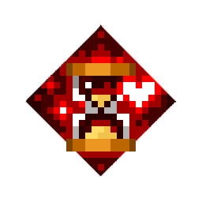 | **Buddy Brew** (Armor) | Drinking a healing potion gives you, nearby allies and your pets Regenerating, healing 5% of max health every second. | of max health healed (5% a second) | 10% over 2 s | 20% over 4 s | 30% over 6 s | Common (1 / 2 / 3) | ✖ | ✖ | None | Potions heal you and allies over time | New, in Regeneration's slot (unused in the game). Allies and pets nearby too. |
|  | **Ignite** (Any) | Attacks on a burning mob deal bonus max health damage and spread the fire to nearby mobs. | of max health as extra damage | 3% | 4% | 5% | Powerful (2 / 3 / 4) | ✖ | ✔ | Emerald Gear | Extra damage to burning mobs | Replaces Lucky Explorer. Arrows count; bosses take 40% of the max-health damage. |
| 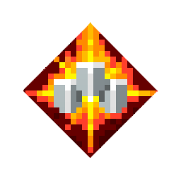 | **Last Stand** (Armor) | While you are below half health, you take 20% / 40% / 60% less damage at tier I / II / III. | less damage below half health | 20% | 40% | 60% | Powerful (2 / 3 / 4) | ✖ | ✖ | None | Less damage taken at low health | New, in Shielding's slot (unused in the game). |
| 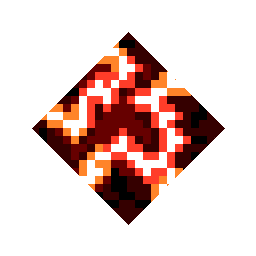 | **Overload** (Any) | Lightning charges the mobs it strikes. Your hits and arrows on a charged mob take 3 / 4 / 5% of its max health and arc to up to 3 / 4 / 5 mobs around it, charging them. | of max health; mobs it arcs to | 3%; 3 | 4%; 4 | 5%; 5 | Powerful (2 / 3 / 4) | ✖ | ✔ | None | Lightning charges mobs to discharge | Replaces Thorns. Lightning Focus boosts it; bosses take 40%. |
|  | **Relentless** (Any) | Melee hits on mobs and every arrow you shoot build up to 10 stacks. Each stack gives 2 / 3 / 4% more damage and attack speed. The stacks fade 3 seconds after your last hit. | damage and attack speed per stack (10 stacks) | +2% | +3% | +4% | Powerful (2 / 3 / 4) | ✖ | ✔ | None | Hits build damage and attack speed | Replaces Levitation Shot. Copies add. |
|  | **Shadowcloak** (Any) | Defeating a mob has a chance to put you in Shadow Form: 15% / 20% / 25% at tier I / II / III. | chance of Shadow Form on a kill | 15% | 20% | 25% | Powerful (2 / 3 / 4) | ✖ | ✔ | Chill Gale Knife Resolute Tempest Knife Tempest Knife | Chance of Shadow Form on kill | New, in Rushdown's slot (it was only on the Tempest Knives, which now have Shadowcloak). Uses kill credit. |
|  | **Shatter** (Any) | Attacks on a chilled or frozen mob deal bonus damage. | more damage to chilled mobs | +100% | +150% | +200% | Powerful (2 / 3 / 4) | ✖ | ✔ | Hungry Horror 2 | Extra damage to chilled mobs | New, in Thrive Under Pressure's slot (a unique-only one). Arrows count. |
|  | **Sweeping Edge** (Melee) | Every melee hit sends out a shockwave that damages the mobs around the one you hit that your swing missed. | splash damage | 20% | 30% | 40% | Common (1 / 2 / 3) | ✖ | ✔ | Cackling Broom 2 | Hits splash nearby mobs | New, in Knockback's slot (unused in the game). |
|  | **Venom Siphon** (Any) | Attacks on a poisoned mob deal bonus max health damage, and you heal 10% of it. | of max health as extra damage | 3% | 4% | 5% | Powerful (2 / 3 / 4) | ✖ | ✔ | None | Drains health from poisoned mobs | New, in Heals Allies' slot (unused in the game). Arrows count; you heal 10% of the damage. |

## Melee

| Icon | Name | Description | Tier text | I | II | III | Rarity (points) | Mobs | Multiple | Built into | Short line | What changed |
|---|---|---|---|---|---|---|---|---|---|---|---|---|
| 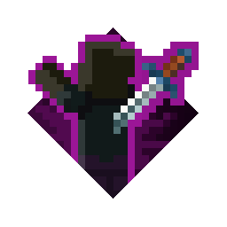 | Ambush | Attacks on mobs that are not actively targeting you deal more damage. | damage done | 50% | 100% | 150% | Common (1 / 2 / 3) | ✖ | ✔ | Backstabber Spine-Chill Spear 2 Swift Striker | Extra damage on unsuspecting enemies | +50% damage per tier (game: +20%). |
|  | Anima Conduit | Each soul absorbed grants a small amount of health. | health gained | 2% | 4% | 6% | Common (1 / 2 / 3) | ✖ | ✔ | Shivering Bow 2 Skull Scythe 2 | Gain health from souls |  |
| 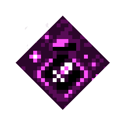 | Artifact Synergy | Using an artifact causes the next attack to deal bonus damage. | Deals X extra damage | 150% | 200% | 250% | Common (1 / 2 / 3) | ✖ | ✖ | Sparkler 3 | Artifact use boosts damage | Bigger bonus. |
| 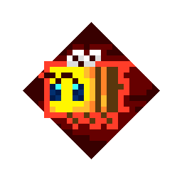 | Busy Bee | Grants a chance for a bee to spawn after defeating a mob, with up to 3 bees joining the hero's side. | chance to summon. | 33% | 67% | 100% | Common (1 / 2 / 3) | ✖ | ✔ | Bee Stinger | Chance to summon a bee | Higher chance. |
|  | Chains | Has a 30% chance to chain a cluster of mobs together and keep them bound for a short time. | seconds duration | 1 | 2 | 3 | Common (1 / 2 / 3) | ✖ | ✔ | Flail Jailor's Scythe | Binds and chains enemies | 45% chance (game: 30%), chains 4 mobs (game: 2). |
| 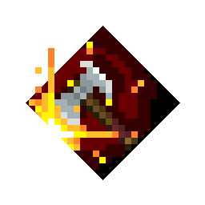 | Committed | Deal increased damage against already wounded mobs. | bonus damage | 0-50% | 0-75% | 0-100% | Common (1 / 2 / 3) | ✖ | ✔ | Fortune spear 2 | Increased damage to wounded mobs |  |
|  | Critical Hit | Gives a chance to inflict critical hits dealing triple damage. | chance to trigger | 10% | 15% | 20% | Powerful (2 / 3 / 4) | ✖ | ✔ | The Last Laugh 2 | Increases critical hit chance | x5 damage (game: x3). |
|  | Dynamo | Adds damage to the next attack after rolling. | damage. | +X | +1.25X | +1.5X | Common (1 / 2 / 3) | ✖ | ✖ | Ancient Bow 2 Corrupted Crossbow Great Axeblade 3 | Rolling makes next attack stronger |  |
|  | Echo | Some attacks can be followed up by another attack in quick succession. | seconds cooldown | 2.1 | 1.1 | 0.1 | Common (1 / 2 / 3) | ✖ | ✖ | Swift Striker 3 Whispering Spear 3 | Sometimes strikes twice | Repeats far sooner. |
|  | Enigma Resonator | Chance to deal triple damage based on the number of souls the hero has. | chance | 0-30% | 0-40% | 0-50% | Common (1 / 2 / 3) | ✖ | ✔ | Feral Soul Crossbow 2 Soul Fists 2 Soul Hunter Crossbow | Souls critical boost | Higher chance. |
| 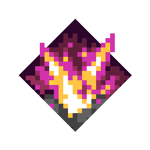 | Exploding | Mobs you defeat explode at once. Mobs the blast defeats explode too. | Deals X% of enemy health as damage | 15% | 25% | 35% | Powerful (2 / 3 / 4) | ✖ | ✖ | Battlestaff of Terror Bonehead Hammer 1 Cursed Axe | Mobs explode after defeated | Goes off at once and chains (mobs the blast kills explode too). Uses kill credit. Also rolls on bows. |
| 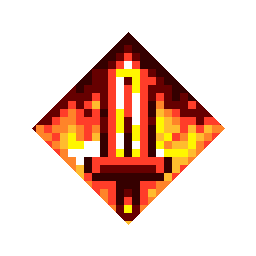 | Fire Aspect | Sets mobs on fire for three seconds, dealing damage over time. Burning mobs lose 3% / 4% / 5% of their max health every second. | damage per second | X | 1.25X | 1.5X | Common (1 / 2 / 3) | ✖ | ✔ | Firebrand 3 | Burns mobs | Burning mobs lose 3 / 4 / 5% of their max health every second (bosses 40% of it). |
|  | Freezing | Slows mobs after hit for three seconds. | reduced speed | -40% | -55% | -70% | Common (1 / 2 / 3) | ✖ | ✖ | Chill Gale knife 3 Fangs of Frost 3 Freezing Foil Frost Scythe Frost Slayer 2 | Slows mobs | Stronger slow. |
|  | Guarding Strike | After defeating a mob, gain a temporary shield that reduces damage by 50%. | seconds duration. | 3 | 4 | 5 | Common (1 / 2 / 3) | ✖ | ✖ | Frost Slayer 2 | Grants temporary shield | Any kill of yours counts (kill credit), not only weapon kills. |
| 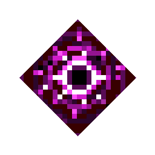 | Gravity | This effect pulls mobs in range toward the weapon's impact point. | seconds duration | 1.0 | 1.5 | 2.0 | Powerful (2 / 3 / 4) | ✖ | ✖ | Cackling Broom 2 Imploding Crossbow Voidcaller Webbed Bow 2 | Pulls in enemies |  |
|  | Illager's Bane | Attacks deal extra damage to Illagers. | increased damage | +50% | +75% | +100% | Common (1 / 2 / 3) | ✖ | ✔ | Bone Cudgel | Extra damage to Illagers | More damage to illagers. |
| 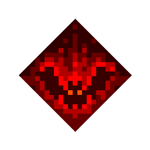 | Leeching | Defeating a mob heals you a small portion of the mob's max health. Kills by your melee attacks heal twice. | of mob's max health | 4% | 5% | 6% | Common (1 / 2 / 3) | ✖ | ✔ | Heartstealer Sinister Sword 2 The Beginning and The End | Leeches health from mobs | Uses kill credit (fewer % since far more kills count). Kills by your melee attack heal twice. Also rolls on bows. |
| 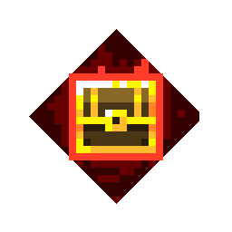 | Looting | Increases the chance for mobs to drop consumables. | increased chance | +100% | +200% | +300% | Common (1 / 2 / 3) | ✖ | ✔ | Fortune spear 3 | Drop More Consumables |  |
|  | Pain Cycle | Attacking drains player's life to grant one stack of Pain Cycle. At 5 stacks, pain is channeled into the next attack. | Max stacks does X damage | Quadruple (4x) | Sextuple (6x) | Octuple (8x) | Common (1 / 2 / 3) | ✖ | ✖ | Sponge Striker 3 | Deal extra damage | Bigger final hit; drains 2% health (game: 3%). |
|  | Poison Cloud | Has a 30% chance to summon a poison cloud that deals damage to enemies in an area for three seconds. Poisoned mobs lose 5% / 7.5% / 10% of their max health every second. | damage per second | X | 2X | 3X | Common (1 / 2 / 3) | ✖ | ✖ | Nightmare's Bite 3 The Green Menace | Spawns Poison Clouds | Always triggers (game: 30%), wider cloud. Poisoned mobs lose 5 / 7.5 / 10% of their max health every second. |
| 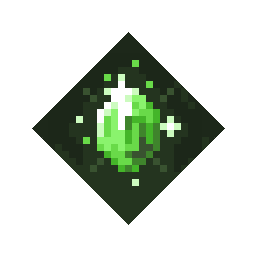 | Prospector | Find more emeralds on fallen enemies. | increased chance | +100% | +200% | +300% | Common (1 / 2 / 3) | ✖ | ✔ | Gilded Glory 3 Opulent Armor 3 The Last Laugh 3 | Mobs drop more emeralds |  |
| 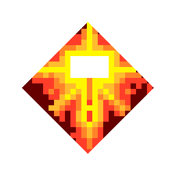 | Radiance | Has a 20% chance to spawn a circular area that heals all allies within it. | health healed | X | 1.5X | 2X | Powerful (2 / 3 / 4) | ✔ | ✔ | Sun's Grace | Heals allies in the area | Always triggers (game: 20%), heals less per proc. |
| 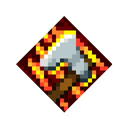 | Rampaging | Defeating a mob increases your attack speed by 50% for a short time. | seconds | 1 | 2 | 3 | Common (1 / 2 / 3) | ✖ | ✔ | Dancer's Sword Maulers 2 | Increases attack speed | Every kill of yours (game: 10% chance on a weapon kill): +50% attack speed. Uses kill credit. |
| 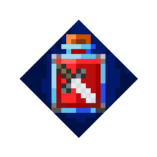 | Refreshment | Defeating a mob reduces health potion's cooldown time, allowing player to heal more quickly. | seconds cooldown speed up | 1.0 | 2.0 | 3.0 | Powerful (2 / 3 / 4) | ✖ | ✔ | Gloopy Bow 2 | Reduce health potion cooldown | Uses kill credit; melee kills also trigger the game's own Refreshment. Speeds up Bottomless Brew's extras too. |
| 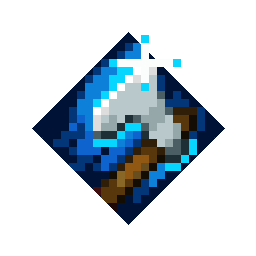 | Sharpness | Sharpens the player's weapon, causing it to deal more damage. | damage | +10% | +21% | +33% | Common (1 / 2 / 3) | ✖ | ✔ | Broadsword 3 Diamond Sword 3 | Extra Damage |  |
|  | Shockwave | The last attack in a combo launches a shockwave that damages enemies, scaling with your weapon. | damage dealt by shockwave | X | 1.5X | 2X | Powerful (2 / 3 / 4) | ✖ | ✔ | Whirlwind | Casts Shockwaves | Plus 50 / 75 / 100% of your weapon hit to the mobs it reaches. |
|  | Smiting | Increases damage against the Undead. | increased damage | +50% | +75% | +100% | Common (1 / 2 / 3) | ✖ | ✔ | None | Extra damage against undead | More damage to the undead. |
|  | Soul Siphon | When hitting an enemy, gain a 20% chance to grant extra souls. | souls | 1 | 3 | 5 | Common (1 / 2 / 3) | ✖ | ✔ | Eternal knife 3 Shivering Bow 2 Skull Scythe 2 | Chance to gain souls | 40% chance (game: 20%). |
|  | Stunning | Chance to temporarily stun enemies. | chance | 15% | 30% | 45% | Common (1 / 2 / 3) | ✖ | ✖ | Highland Axe 3 | Chance to stun enemies | Higher chance. |
|  | Swirling | Hitting an enemy with the last attack in a combo performs a swirling attack that damages nearby enemies, scaling with your weapon. | damage dealt by wind | X | 1.5X | 2X | Powerful (2 / 3 / 4) | ✖ | ✔ | Sheer Daggers 3 | Last attack does area damage | Plus 50 / 75 / 100% of your weapon hit to the mobs it reaches. |
|  | Thundering | Every hit summons a lightning strike that damages nearby mobs and takes 1 / 2 / 3% of their max health. | damage dealt by lightning | X | 2X | 3X | Common (1 / 2 / 3) | ✖ | ✔ | Stormlander 3 | Fires lightning bolts | Strikes on every hit (game: 30%), less flat damage, plus 1 / 2 / 3% of max health per strike. Lightning Focus boosts it. |
|  | Unchanting | Deals more damage to enchanted enemies. | bonus damage | +50% | +75% | +100% | Common (1 / 2 / 3) | ✖ | ✔ | Sinister Sword 2 Spellbound Crossbows | Strong vs Enchanted Mobs |  |
|  | Void Strike | Attacking a target applies a damage multiplier that rises steadily to a max level, then is removed. | damage multiplier | 200% | 400% | 600% | Powerful (2 / 3 / 4) | ✖ | ✖ | Call of the Void Phantom Bow 2 Spine-Chill Spear 2 | Applies Rising Damage Multiplier |  |
|  | Weakening | The player's attacks decrease the attack damage of all nearby enemies for five seconds. | reduction in damage | 20% | 30% | 40% | Common (1 / 2 / 3) | ✖ | ✔ | Nameless Blade | Weakens enemy attacks |  |

## Ranged

| Icon | Name | Description | Tier text | I | II | III | Rarity (points) | Mobs | Multiple | Built into | Short line | What changed |
|---|---|---|---|---|---|---|---|---|---|---|---|---|
|  | Accelerate | Increases attack speed for each consecutive shot. Resets one second after the attack. | increase per shot | 8% | 10% | 12% | Common (1 / 2 / 3) | ✔ | ✖ | Auto Crossbow Mechanical Shortbow Sugar Rush 2 | Firerate increases upon firing |  |
|  | Artifact Charge | When using an artifact, the player's next few attacks become charged. | Attacks charged | Next | Next 2 | Next 3 | Common (1 / 2 / 3) | ✖ | ✖ | None | Charged Attacks After Artifact Use |  |
|  | Anima Conduit | Each soul absorbed grants a small amount of health. | of max health gained per soul | 4% | 6% | 8% | Common (1 / 2 / 3) | ✖ | ✔ | Shivering Bow 2 Skull Scythe 2 | Gain health from souls |  |
| 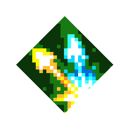 | Bonus Shot | Firing a shot also fires a second shot at a nearby enemy. The second shot has reduced damage. | damage per shot | 30% | 50% | 75% | Common (1 / 2 / 3) | ✔ | ✔ | Butterfly Crossbow 3 Twin Bow 3 | Shoots two enemies at once | Much stronger second arrow. |
|  | Burst Bowstring | Shoots nearby mobs when the player rolls, costing one arrow per roll. Projectiles deal 40% of a charged shot's damage. | target | 1 | 2 | 3 | Common (1 / 2 / 3) | ✖ | ✖ | Haunted Bow 2 | Shoots arrows when rolling | Also rolls on armor. |
|  | Chain Reaction | Has a chance to fire five arrows in all directions on impact. | chance to trigger | 10% | 20% | 30% | Powerful (2 / 3 / 4) | ✔ | ✔ | Firebolt Thrower | Chance of chain reaction |  |
|  | Committed | Deal increased damage against already wounded mobs. | bonus damage | 0-50% | 0-75% | 0-100% | Common (1 / 2 / 3) | ✖ | ✔ | Fortune spear 2 | Increased damage to wounded mobs |  |
|  | Critical Hit | Gives a chance to inflict critical hits dealing triple damage. | chance to trigger | 10% | 15% | 20% | Powerful (2 / 3 / 4) | ✖ | ✔ | The Last Laugh 2 | Increases critical hit chance | x5 damage (game: x3). |
| 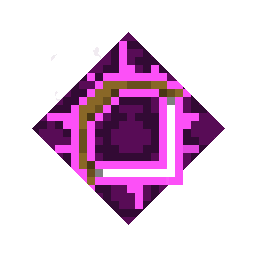 | Cooldown Shot | Artifact cooldowns are decreased when attacking with a charged shot. | second cooldown reduction | 0.5 | 1.0 | 1.5 | Common (1 / 2 / 3) | ✖ | ✔ | Gloopy Bow 2 | Charged Shot Reduces Cooldown |  |
| 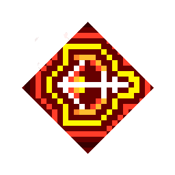 | Dynamo | Adds damage to the next attack after rolling. | damage | +X | +2X | +3X | Common (1 / 2 / 3) | ✖ | ✖ | Ancient Bow 2 Corrupted Crossbow Great Axeblade 3 | Boosts next attack on roll |  |
| 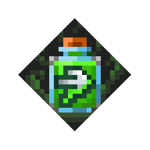 | Dipping Poison | When you use a health potion, you are given a quiver of Poison Arrows. Poisoned mobs lose 5% / 7.5% / 10% of their max health every second. | poison arrows | 10 | 15 | 20 | Common (1 / 2 / 3) | ✖ | ✖ | None | Health Potion gives Poison Arrows | More arrows. Poisoned mobs lose 5 / 7.5 / 10% of their max health every second. |
|  | Enigma Resonator | Chance to deal triple damage based on the number of souls the player has. | chance | 0-30% | 0-40% | 0-50% | Common (1 / 2 / 3) | ✖ | ✔ | Feral Soul Crossbow 2 Soul Fists 2 Soul Hunter Crossbow | Souls critical boost | Higher chance. |
|  | Fire Aspect | Sets mobs on fire for three seconds, dealing damage over time. Burning mobs lose 3% / 4% / 5% of their max health every second. | damage per second | X | 1.25X | 1.5X | Common (1 / 2 / 3) | ✖ | ✖ | Firebrand 3 | Sets mobs on fire | Burning mobs lose 3 / 4 / 5% of their max health every second (bosses 40% of it). |
| 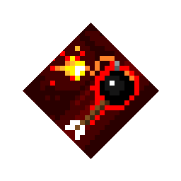 | Fuse Shot | Every few shots has a timed charge that explodes one second after impact, dealing 100% damage to nearby mobs. | Every X shot | fifth | fourth | third | Common (1 / 2 / 3) | ✖ | ✔ | Call of the Void Red Snake 3 | Chance for arrows to explode | Explodes almost at once (game: after 1 s), 2x damage, 1.5x radius. |
|  | Gravity | This effect pulls mobs in range toward the weapon's impact point. | second duration | 1.0 | 1.5 | 2.0 | Powerful (2 / 3 / 4) | ✔ | ✖ | Cackling Broom 2 Imploding Crossbow Voidcaller Webbed Bow 2 | Pulls in enemies |  |
|  | Growing | The fired shot grows in the air, dealing extra damage to distant targets. | maximum damage | 25% | 50% | 75% | Common (1 / 2 / 3) | ✔ | ✖ | Baby Crossbows 3 Bonebow 3 | Arrows grow size | Reaches full damage sooner (10 blocks instead of 16). |
|  | Infinity | Chance to immediately replenish an arrow after shooting. | chance of arrow not being used | 16% | 32% | 48% | Common (1 / 2 / 3) | ✖ | ✔ | Hunter's Promise 3 | Chance to regain arrows |  |
|  | Multishot | Grants the chance to fire five arrows at once. | chance to trigger | 20% | 30% | 40% | Common (1 / 2 / 3) | ✔ | ✖ | Bow of Lost Souls | Chance for multishot |  |
|  | Overcharge | Continue to hold the ranged attack button to double, triple, or quadruple charge a bow, increasing its damage each time. | Can charge x times. | 2 | 3 | 4 | Powerful (2 / 3 / 4) | ✔ | ✖ | Sugar Rush 2 | Boost charge shot |  |
|  | Piercing | Fired arrows sometimes gain the piercing effect, which allows them to fly through multiple mobs. | Every X arrow | 3rd | 2nd | Every arrow | Common (1 / 2 / 3) | ✔ | ✖ | Nautical Crossbow Pride of the Piglins The Slicer 3 | Chance to fire piercing bolts |  |
|  | Poison Cloud | Has a 30% chance to summon a poison cloud that deals damage to enemies in an area for three seconds. Poisoned mobs lose 5% / 7.5% / 10% of their max health every second. | damage per second | X | 2X | 3X | Common (1 / 2 / 3) | ✔ | ✖ | Nightmare's Bite 3 The Green Menace | Spawns Poison Clouds | Always triggers (game: 30%), wider cloud. Poisoned mobs lose 5 / 7.5 / 10% of their max health every second. |
|  | Power | Power boosts arrow damage. | damage | +10% | +21% | +33% | Common (1 / 2 / 3) | ✖ | ✖ | Doom Crossbow 2 Elite Power Bow 3 Master's Bow 3 | Greater damage |  |
|  | Prospector | Find more emeralds on fallen enemies. | increased chance | +100% | +200% | +300% | Common (1 / 2 / 3) | ✖ | ✔ | Gilded Glory 3 Opulent Armor 3 The Last Laugh 3 | Mobs drop more emeralds |  |
|  | Punch | Boosts arrow pushback. | knockback | 700% | 1100% | 1500% | Common (1 / 2 / 3) | ✖ | ✖ | Doom Crossbow 3 | Additional knockback | Much stronger knockback. |
|  | Radiance Shot | Has a 50% chance to spawn a circular area that heals all allies within it. | health healed | X | 1.5X | 2X | Common (1 / 2 / 3) | ✔ | ✔ | Sabrewing 2 | Heals allies in the area | Always triggers (game: 50%), heals less per proc. |
|  | Rapid Fire | Increases attack speed. | attack speed | +20% | +35% | +50% | Common (1 / 2 / 3) | ✔ | ✖ | Azure Seeker 3 Purple Storm | Increased fire rate | Faster shooting. |
| 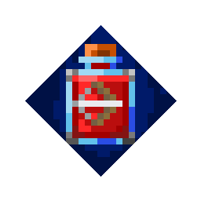 | Refreshment | Defeating a mob reduces health potion cooldown time for quicker healing. | # second(s) cooldown reduction | 1 | 2 | 3 | Powerful (2 / 3 / 4) | ✖ | ✔ | Gloopy Bow 2 | Reduce health potion cooldown | Uses kill credit; melee kills also trigger the game's own Refreshment. Speeds up Bottomless Brew's extras too. |
|  | Ricochet | Small chance for arrows to ricochet off mobs. | chance to trigger | 20% | 40% | 60% | Common (1 / 2 / 3) | ✖ | ✖ | Echo of the Valley Lightning Harp Crossbow 2 Slayer Crossbow 3 | Hits multiple targets |  |
|  | Roll Charge | After rolling the next shot is charged. | Charged Shot for X Seconds | 1 | 2 | 3 | Common (1 / 2 / 3) | ✖ | ✖ | Burst Gale Bow Haunted Bow 2 Weeping Vine Bow | Rolling charges next arrow |  |
| 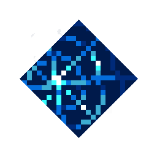 | Shock Web | Beams of lightning connect the last few charged arrows fired, which deal lightning damage to enemies who touch a beam. | Up to X beams | 1 | 2 | 3 | Powerful (2 / 3 / 4) | ✖ | ✔ | Webbed Bow 2 | Beams cause damage | Double damage. |
|  | Smiting | Increases damage against the Undead. | increased damage | +50% | +75% | +100% | Common (1 / 2 / 3) | ✖ | ✖ | None | Extra damage against undead | More damage to the undead. |
|  | Soul Siphon | When hitting an enemy, gain a 20% chance to grant extra souls. | souls | 1 | 3 | 5 | Common (1 / 2 / 3) | ✖ | ✔ | Eternal knife 3 Shivering Bow 2 Skull Scythe 2 | Chance to gain souls | 40% chance (game: 20%). |
|  | Supercharge | Charged shots deal more damage and have more pushback. | increased damage | +40% | +60% | +80% | Common (1 / 2 / 3) | ✖ | ✔ | Guardian Bow 3 Phantom Bow 2 | Strong charged attacks | Bigger charged shots. |
|  | Tempo Theft | Steals a small amount of a mob's movement speed and gives it to the player for four seconds. | stolen speed | 17% | 33% | 50% | Powerful (2 / 3 / 4) | ✔ | ✖ | Nocturnal Bow Shrieking Crossbow 2 | Steals speed |  |
|  | Unchanting | Deals more damage to enchanted enemies. | bonus damage | +50% | +75% | +100% | Common (1 / 2 / 3) | ✖ | ✔ | Sinister Sword 2 Spellbound Crossbows | Strong vs Enchanted Mobs |  |
|  | Void Strike | Attacking a target applies a damage multiplier that rises steadily to a max level, then is removed. Affected mobs are affected with void touched. | max damage multiplier | 100% | 200% | 300% | Powerful (2 / 3 / 4) | ✖ | ✖ | Call of the Void Phantom Bow 2 Spine-Chill Spear 2 | Applies Rising Damage Multiplier |  |
|  | Wild Rage | Hitting an enemy has a chance to send it into a rage, making it hostile toward everyone. | chance to trigger | 30% | 45% | 60% | Common (1 / 2 / 3) | ✖ | ✔ | Love Spell Bow The Pink Scoundrel | Chance to enrage mobs | Higher chance. |

## Armor

| Icon | Name | Description | Tier text | I | II | III | Rarity (points) | Mobs | Multiple | Built into | Short line | What changed |
|---|---|---|---|---|---|---|---|---|---|---|---|---|
|  | Acrobat | Reduces the cooldown time between rolls. | reduced cooldown | 15% | 30% | 45% | Common (1 / 2 / 3) | ✖ | ✖ | Black Wolf Armor 3 Living Vines Armor 2 | Reduced roll cooldown |  |
|  | Bag of Souls | Increases the maximum number of souls that can be carried. | extra souls | 100% | 200% | 300% | Common (1 / 2 / 3) | ✖ | ✖ | Verdant Robe | Increase Maximum Souls | More souls. |
|  | Beast Boss | Increases the amount of damage dealt by pets. | Pet damage | 50% increase | 100% increase | 150% increase | Common (1 / 2 / 3) | ✖ | ✖ | None | Pets deal more damage | More pet damage. |
|  | Beast Burst | Using a healing potion causes an explosion at pets' locations, dealing damage to mobs around them. | explosion damage | 2X | 4X | 6X | Common (1 / 2 / 3) | ✖ | ✖ | None | Explosion at Pets' Location | Double damage. |
|  | Beast Surge | Using health potion boosts pets' attack and movement speed for 10 seconds. | Pets' attack and speed X | +50% | +100% | +150% | Common (1 / 2 / 3) | ✖ | ✖ | Arctic Fox Armor 2 | Pet Attack and Move Boost | Lasts 20 s (game: 10 s). |
|  | Burning | Every 0.5 seconds damages all nearby enemies. Burning mobs lose 3% / 4% / 5% of their max health every second. | damage | X | 2X | 3X | Common (1 / 2 / 3) | ✔ | ✔ | Cauldron Armor 2 Ember Robe 3 | Burns nearby enemies | Wider (4 blocks, game: 3). Burning mobs lose 3 / 4 / 5% of their max health every second. |
|  | Chilling | Emits a blast every two seconds that reduces the movement and attack speed of nearby enemies for one second. | reduced speed | -20% | -40% | -60% | Powerful (2 / 3 / 4) | ✔ | ✖ | Frost Armor 3 Hungry Horror 2 | Emits a chilling aura |  |
| 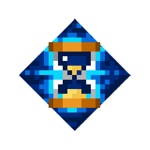 | Cool Down | Reduces the cool-down time between uses of artifacts. | reduced cool-down | -18% | -29% | -38% | Common (1 / 2 / 3) | ✖ | ✔ | None | Reduced Artifact Cooldown |  |
| 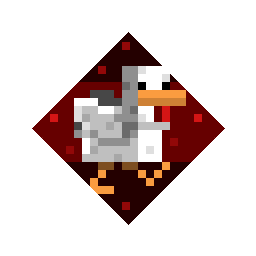 | Cowardice | Deal increased ranged and melee damage while at full health. | increased ranged and melee damage | +40% | +50% | +60% | Common (1 / 2 / 3) | ✖ | ✖ | None | Increase damage at full HP | More damage at full health. |
| 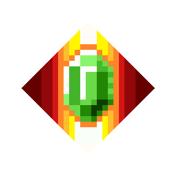 | Death Barter | The first set of Emeralds collected are stored and then spent to save the player from death. | Costs X Emeralds | 150 | 100 | 50 | Powerful (2 / 3 / 4) | ✖ | ✖ | Gilded Glory 3 The Spooky Gourdian 2 | Can spend emeralds to cheat death |  |
| 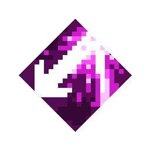 | Deflect | Grants a small chance to deflect incoming projectiles. | chance to trigger | 30% | 40% | 50% | Common (1 / 2 / 3) | ✔ | ✖ | Shulker Armor Sturdy Shulker Armor | Deflects enemy projectiles | Higher chance. |
|  | Electrified | Rolling zaps two nearby enemies with lightning bolts, dealing damage. | Deals X damage | X | 2X | 3X | Common (1 / 2 / 3) | ✔ | ✔ | Cloaked Skull 2 | Rolling zaps mobs | Its zap also takes 4 / 6 / 8% of max health. Lightning Focus boosts it. |
| 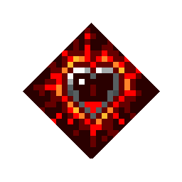 | Final Shout | When the player's health drops below 25%, all artifacts are used (ignoring cool-down periods). | Up to every X second | 8th | 6th | 4th | Powerful (2 / 3 / 4) | ✖ | ✖ | The Spooky Gourdian 2 | Artifacts activate on low HP | Triggers below 50% health (game: 25%), more often. |
|  | Fire Focus | Increase fire damage dealt by the player. | increases fire damage | +50% | +100% | +150% | Powerful (2 / 3 / 4) | ✖ | ✔ | Cauldron Armor 2 | Increases fire damage | Bigger boost. |
|  | Fire Trail | Rolling creates a trail of fire that deals damage to mobs for four seconds. Burning mobs lose 3% / 4% / 5% of their max health every second. | fire damage per second | X | 2X | 3X | Common (1 / 2 / 3) | ✔ | ✔ | Ghost Kindler 3 | Spawns fire on roll | Lasts 6 s (game: 4 s). Burning mobs lose 3 / 4 / 5% of their max health every second. |
|  | Frenzied | Player's attack speed is increased while at less than half health. | melee and ranged attack speed | +40% | +50% | +60% | Common (1 / 2 / 3) | ✔ | ✖ | Hungriest Horror 2 | Attack speed boost at low HP | Faster attacks at low health. |
|  | Health Synergy | Regain a small amount of health when activating any artifact. | health regained | 5% | 7.5% | 10% | Common (1 / 2 / 3) | ✖ | ✖ | None | Health restored on artifact use | Bigger heal. |
|  | Life Boost | Maximum health increases each time the player loses a life. | extra health | 20% | 40% | 60% | Common (1 / 2 / 3) | ✖ | ✖ | None | Health boost after respawn | More health. |
|  | Lightning Focus | All lightning damage you deal is increased: lightning artifacts, Thundering, Electrified and Overload. | increased lightning damage | +25% | +50% | +75% | Powerful (2 / 3 / 4) | ✖ | ✔ | Cloaked Skull 2 | Increases lightning damage | Also boosts Thundering's, Electrified's and Overload's max-health damage. |
| 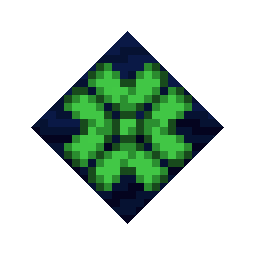 | Luck of the Sea | Increases luck, boosting the chance of unique rare drops. | luck increase | 25% | 50% | 75% | Common (1 / 2 / 3) | ✖ | ✖ | None | Increases luck | More luck. |
|  | Multi-Roll | Grants extra rolls. | Grants X rolls | 2 | 3 | 4 | Powerful (2 / 3 / 4) | ✖ | ✖ | Goat Gear 2 | Gives an extra roll |  |
|  | Poison Focus | Increased poison damage dealt by the player. | Increases poison damage | +50% | +100% | +150% | Powerful (2 / 3 / 4) | ✖ | ✔ | Living Vines Armor 2 | Increases poison damage | Bigger boost. |
| 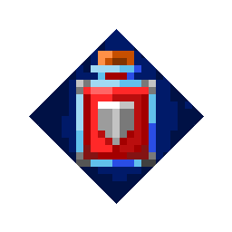 | Potion Barrier | Take -90% damage for a short duration when using a healing potion. | seconds duration | 5 | 7 | 9 | Common (1 / 2 / 3) | ✖ | ✖ | Stalwart Armor | Increased defense on potion use |  |
|  | Prospector | Find more emeralds on fallen enemies. | increased chance | +100% | +200% | +300% | Common (1 / 2 / 3) | ✖ | ✔ | Gilded Glory 3 Opulent Armor 3 The Last Laugh 3 | Mobs drop more emeralds |  |
|  | Protection | Reduces damage taken. | damage taken | -15% | -25% | -35% | Powerful (2 / 3 / 4) | ✔ | ✔ | None | Damage reduction | Less damage taken. |
| 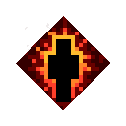 | Reckless | Decreases player health by 40% while increasing melee damage. | damage increase | +100% | +125% | +150% | Powerful (2 / 3 / 4) | ✖ | ✔ | Hungriest Horror 2 | Melee Damage Increased | More damage. |
|  | Rush | Increases movement speed for one second after taking damage. | % speed increase. | 50% | 100% | 150% | Common (1 / 2 / 3) | ✔ | ✖ | Nimble Turtle Armor 3 | Boost speed after hit | Faster. |
|  | Shadow Surge | Mobs defeated while in Shadow Form grant extra souls. | % Souls per mob. | 6 | 12 | 16 | Common (1 / 2 / 3) | ✖ | ✖ | None | Shadow Form grants more souls |  |
|  | Snowball | Fires a snowball at a nearby enemy every few seconds, briefly stunning it. | Triggers every X seconds | 3 | 2 | 1 | Common (1 / 2 / 3) | ✖ | ✔ | Frost Bite 3 | Spawns a snowy companion | Throws more often. |
|  | Soul Focus | Increases soul damage dealt by the player. | increased soul damage | +25% | +50% | +75% | Powerful (2 / 3 / 4) | ✖ | ✔ | None | Increases soul damage | Like the other Focuses (game: +10 / 20 / 30%). |
|  | Soul Speed | Gathering a soul causes a gain of 5% stacking movement speed boost for a short time. | seconds duration | 3 | 5 | 7 | Common (1 / 2 / 3) | ✖ | ✖ | None | Speed boost on soul pickup | Double speed bonus. |
|  | Speed Synergy | When activating any artifact, gain +20% movement speed for a short time. | second duration | 1 | 2 | 3 | Common (1 / 2 / 3) | ✖ | ✖ | None | Speed boost on artifact use | +50% speed (game: +20%). |
| 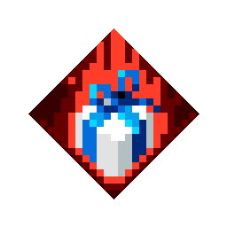 | Surprise Gift | Using a healing potion sometimes also creates a random consumable. | chance to trigger | 50% | 100% | 150% | Common (1 / 2 / 3) | ✖ | ✖ | Golden Piglin Armor 3 Sweet Tooth 2 | Can get consumable on potion use |  |
|  | Swiftfooted | Rolling increases movement speed for three seconds. | movement speed | +30% | +40% | +50% | Common (1 / 2 / 3) | ✖ | ✖ | Highland Armor | Gains Speed after Dodge | Lasts 5 s (game: 3 s). |
| 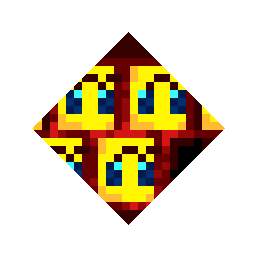 | Tumblebee | Chance to summon a bee when rolling, with up to 3 bees joining the player's side. | chance to summon | 33% | 67% | 101% | Common (1 / 2 / 3) | ✖ | ✖ | None | Spawn bees when rolling |  |

## Unique-only (built into one item, never rolled)

| Icon | Name | Description | Tier text | I | II | III | Rarity (points) | Mobs | Multiple | Built into | Short line | What changed |
|---|---|---|---|---|---|---|---|---|---|---|---|---|
|  | Emerald Shield | Invulnerability on emerald collection | - | - | - | - | Common (1 / 2 / 3) | ✖ | ✖ | Opulent Armor | - |  |
| 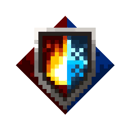 | Environmental Protection | Environmental damage resistance | - | - | - | - | Common (1 / 2 / 3) | ✖ | ✖ | Rugged Climbing Gear | - |  |
|  | Jungle Poison | Inflicts poison | - | - | - | - | Common (1 / 2 / 3) | ✖ | ✖ | Encrusted Anchor Vine Whip | - |  |
|  | Reliable Ricochet | Charged arrows ricochet off of mobs up to three times. | - | - | - | - | Common (1 / 2 / 3) | ✖ | ✖ | Bubble Burster | - |  |
|  | Shadow Shot | Chance of Shadow Form on kills | - | - | - | - | - | ✖ | ✖ | Shadow Crossbow Shrieking Crossbow Veiled Crossbow | - |  |
|  | Shared Pain | Excess damage hits nearby mobs | - | - | - | - | - | ✖ | ✖ | The Starless Night | - |  |

Frost Shot (Freezing Ranged) and Wither are left out: the game gave them no card text, so the mod doesn't roll them (see the README).
